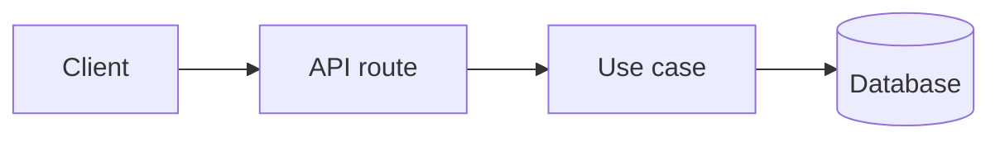
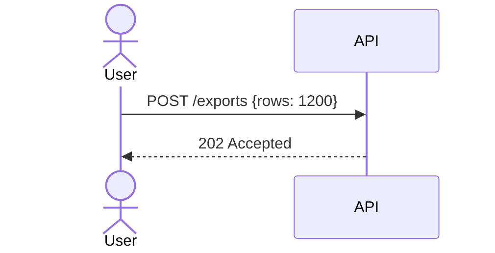

# plan.md template

Copy this shape. Replace everything in `<angle brackets>`; delete sections' placeholder comments. Keep the headings in this order — the page mirrors them, and reviewers learn where to look.

````markdown
---
title: <Feature name>
version: v0.1
status: draft            # draft | in review | agreed | building | done
jira: <PROJ-123, or none until a ticket is linked>
jira_url: <https://…/browse/PROJ-123, or omit>
artifact: <filled in after first publish>
updated: <YYYY-MM-DD>
---

# <Feature name>

> **Version** v0.1 · **Status** draft · **Jira** [PROJ-123](<url>) _(or: not linked yet)_ · **Updated** <YYYY-MM-DD> · **Shared page** <artifact url>

## Brief

<3–5 plain sentences. What we're building, why, for whom, and what "done" looks like.
No jargon that isn't in the glossary.>

## Glossary

| Term | Meaning |
|------|---------|
| <Term> | <One plain line. Say what it is in this codebase, not the textbook definition.> |

## Plan outline



<One or two sentences on how the parts above fit together.>

### Phase 1 — <name>

1. **<Step>** — <what changes>.
   - Where: `<path/to/file.ts>`
   - Done when: <observable check — a test passes, an endpoint returns X>
2. …

### Phase 2 — <name>

…

## Use cases

### Happy path — <short name>

**Scenario:** <who does what, in a sentence>
**Input:** <concrete values>



**Expected result:** <what the user sees / what's stored>

### Extreme path — <short name>

<Same shape. Pick the edge that actually stresses the design: largest input, zero items,
concurrency, slow dependency. Say why this one is the extreme that matters.>

### Error path — <short name>

<Same shape. Say what fails, what the user sees, what's retried or rolled back, and what's logged.>

## Code sketches

### <What this sketch shows>

<One sentence on what the code does and where it would live.>

```js
/**
 * @param {number} rows
 * @returns {number}
 */
function batchCount(rows) { … }
```

```ts
function batchCount(rows: number): number { … }
```

```go
func BatchCount(rows int) (int, error) { … }
```

## Key decisions

- **D1** — <decision in one line> ([why](decisions.md#d1))
- **D2** — …

## Open questions & risks

- <Question or risk> — <owner or next step>

## Changelog

- **v0.1** — <YYYY-MM-DD> — First draft.

## Appendix

<Include only the groups this plan needs. Number items A1, A2… and link to them from the body.>

### Data models

#### A1. <Model name>

<One sentence: what this is and which steps use it (Phase 1 step 2, happy path).>

```ts
/** <what it is> */
export interface ExportJob {
  id: string;          // uuid
  status: "queued" | "running" | "done" | "failed";
  rowCount: number;    // rows requested, ≥ 0
  createdAt: Date;
}
```

```go
// ExportJob is <what it is>.
type ExportJob struct {
	ID        string    `json:"id"`
	Status    string    `json:"status"`   // queued | running | done | failed
	RowCount  int       `json:"rowCount"` // ≥ 0
	CreatedAt time.Time `json:"createdAt"`
}
```

```sql
-- only when the database schema changes
CREATE TABLE export_jobs ( … );
```

| Field | Type | Meaning |
|-------|------|---------|
| `status` | enum | Where the job is in its lifecycle |

### Code

#### A2. <What it is>

<One sentence + where it would live.> <Code in JS/TS/Go if it's shared logic, or its real language otherwise.>

### API examples

#### A3. <Endpoint> — happy / extreme / error

```http
POST /exports
Content-Type: application/json

{"rows": 1200}
```

```json
{"id": "…", "status": "queued"}
```

### Other

#### A4. <Config / flags / links>

- <item> — <why it matters>
````

## decisions.md header

```markdown
# Decisions — <Feature name>

Every question raised while planning, the options considered, what was decided and why.
Newest decisions are appended at the bottom. Reversed decisions are kept and marked superseded.
```

Entries follow the format in SKILL.md. Put `<a id="d<n>"></a>` on the line above each `### D<n>. <question>` heading — GitHub's auto-generated heading anchors include the whole question, so the explicit id is what makes `decisions.md#d<n>` links work.
